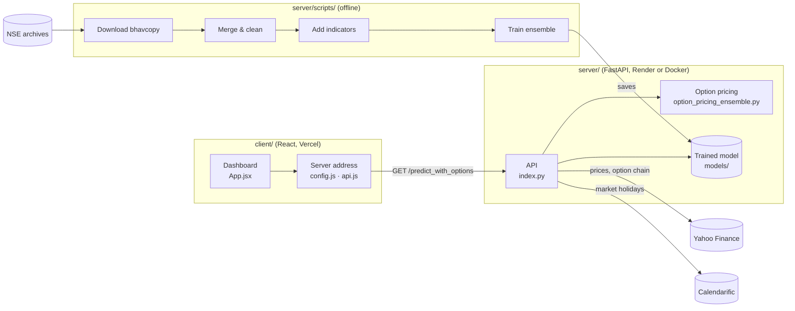

# F&O Market Prediction

Predicts whether an Indian stock or index (NSE) will close **up or down**, then suggests an options trade around that call: strike, stop-loss, exit target, weekly expiry and an estimated option premium.

A React dashboard sends a symbol to a FastAPI server. The server pulls live prices from Yahoo Finance, works out about 37 technical indicators, runs a model trained on years of NSE futures & options data, and prices the suggested option with Black-Scholes and a binomial tree.

> Educational project. The output is not financial advice.

## How it fits together



| Part | Where | What it does |
|---|---|---|
| Prediction dashboard | `client/src/App.jsx` | Enter a symbol (e.g. `RELIANCE.NS`, `^NSEI`), see the current data, indicators and the trade suggestion. |
| Server connection | `client/src/config.js`, `client/src/api.js` | Holds the backend URL and the fetch calls. |
| Prediction API | `server/index.py` | Fetches live data, computes indicators, runs the model, picks a strike and stop-loss, works out the next weekly (Tuesday) expiry. |
| Option pricing | `server/option_pricing_ensemble.py` | Blends Black-Scholes (60%) with a binomial tree (40%) to estimate the premium. |
| Model wrappers | `server/models/ensemble.py` | Averages several classifiers' probabilities into one vote. |
| Training pipeline | `server/scripts/`, `server/run_full_pipeline.sh` | Downloads NSE bhavcopy files, cleans them, adds indicators and trains the up/down model. |
| Older apps | `server/deploy_xgboost_api_options_yf_fastapi.py`, `server/streamlit_app.py` | An earlier API version and a Streamlit dashboard, kept for reference. |
| Deployment | `docker-compose.yml`, `server/Dockerfile*`, `server/render.yaml`, `vercel.json`, `*.sh` | Docker, Render and Vercel setup plus deploy and health-check scripts. |

## The model

- **Target:** whether a stock future (`FUTSTK`) closes above its open that day (1 = up, 0 = down).
- **Features:** contract data (strike, OHLC, settle price, contracts, value, open interest, change in OI) plus SMA, EMA (9/21/50/200), RSI, MACD, Bollinger Bands, Stochastic, ATR, ROC, OBV, VWAP, ADX, CCI, Williams %R, momentum, CMF, Parabolic SAR and Aroon.
- **Training** (`server/scripts/train_model.py`): Random Forest, LightGBM and CatBoost combined in a soft-voting ensemble, with a tuned Logistic Regression kept for comparison. Saved to `server/models/fno_ensemble_model.pkl`.
- **Serving:** the live API currently loads the XGBoost model at `server/models/fno_xgboost_model.json`.

## API

| Method | Path | Returns |
|---|---|---|
| GET | `/` | Health check |
| GET | `/fetch_yfinance?symbol=…` | Latest price data and indicators for a symbol |
| GET | `/predict_live?symbol=…` | Direction, confidence, strike, stop-loss and expiry |
| GET | `/predict_with_options?symbol=…` | Everything above plus option premium, option stop-loss/exit and per-model details |
| POST | `/predict` | Prediction from a JSON body `{ "symbol": "…" }` |
| GET | `/debug_expiry` | The expiry date the server would use right now |

## Running it locally

**Server** (Python 3.11, needs the TA-Lib C library installed):

```bash
cd server
pip install -r requirements.txt
uvicorn index:app --reload        # http://localhost:8000
```

Or with Docker from the repo root:

```bash
docker-compose up --build -d
```

**Dashboard:**

```bash
cd client
npm install
npm start                          # http://localhost:3000
```

The dashboard's server address is set in `client/src/config.js`. It currently points at the hosted Render server in both modes, so change it to `http://localhost:8000` to use a local server.

**Retraining.** The scripts in `server/scripts/` run in this order:

1. `download_nse.py`: download daily F&O bhavcopy files into `server/data/raw/`
2. `filter_all_fno.py`: merge them into one file
3. `preprocess_data.py`: clean it into `data/processed/`
4. `feature_engineering.py`: add the indicators into `data/featured/`
5. `train_model.py`: train and save the ensemble into `server/models/`

`server/run_full_pipeline.sh` then retrains the model, adds the predicted direction to the options data and runs the option-price step. Some scripts expect to run from the repo root (`server/data/...`) and others from `server/` (`data/...`), so check each script's paths before you run it.

## Deployment

- **Server:** Render (`server/render.yaml`), Railway or any Docker host. Set the root directory to `server`.
- **Dashboard:** Vercel, with the root directory set to `client`.

More detail in [QUICKSTART.md](QUICKSTART.md), [DEPLOYMENT.md](DEPLOYMENT.md) and [RENDER_DEPLOY.md](RENDER_DEPLOY.md).

## Known issues

- The Calendarific API key is written directly into `server/index.py` and `server/deploy_xgboost_api_options_yf_fastapi.py`. It should move to an environment variable and the old key should be rotated.
- CORS allows every origin (`"*"`) with credentials on.
- The dashboard first tries `/predict_combined`, which the server doesn't have, then falls back to `/predict_with_options`.
- The files in the top-level `scripts/` folder are empty placeholders.
- `server/venv/` and `client/node_modules/` are committed, which makes the repo very large.

## Tech stack

Python · FastAPI · XGBoost · scikit-learn · LightGBM · CatBoost · pandas · TA-Lib · yfinance · React 19 · Docker · Render · Vercel
